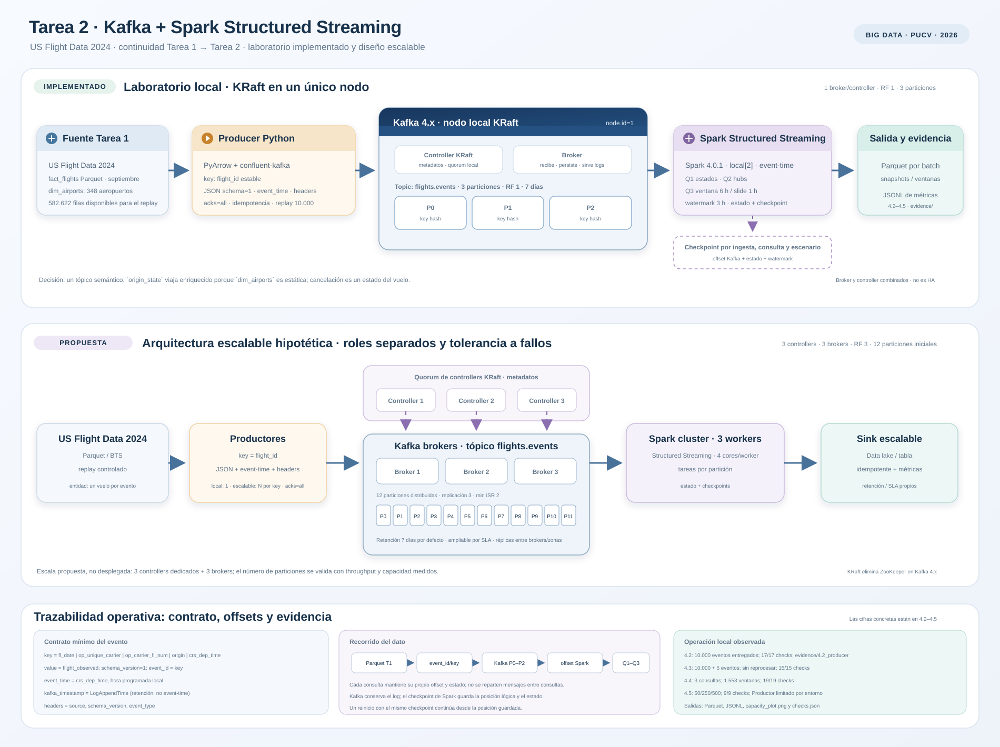
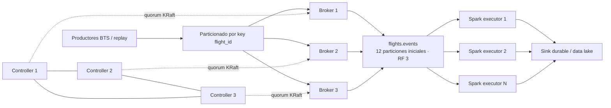

# Diseño de arquitectura



## Cómo leer el diagrama

El diagrama tiene tres franjas y se lee de izquierda a derecha:

1. **Laboratorio local implementado.** Es el flujo que realmente se ejecuta en Colab: Parquet de septiembre, Producer Python, un nodo Kafka KRaft con tres particiones y RF 1, Spark Structured Streaming con tres consultas, salidas Parquet/JSONL y checkpoints independientes.
2. **Propuesta escalable hipotética.** Separa tres controllers de tres brokers, usa 12 particiones iniciales, RF 3 con `min.insync.replicas=2`, un clúster Spark con workers y un sink durable. **No se despliega en Colab.**
3. **Trazabilidad operativa.** Resume el contrato del evento, el recorrido desde la fila del Parquet hasta la consulta, la diferencia entre el offset de Kafka y el checkpoint de Spark, y las evidencias reales de 4.2–4.5.

El laboratorio usa un solo proceso/nodo que combina **broker y controller** KRaft. Esta configuración sirve para reproducir el flujo, pero **no tolera la caída del nodo** y utiliza replication factor 1. El topic `flights.events` tiene tres particiones y siete días de retención. El replay de laboratorio usa 10.000 eventos de 2024; la fuente de septiembre conserva 582.622 filas para poder ampliar las pruebas.

### Contrato del evento y relojes

La key es estable:

```text
fl_date | op_unique_carrier | op_carrier_fl_num | origin | crs_dep_time
```

El payload es JSON con `schema_version=1`, `event_type=flight_observed`, `event_id`, `event_time`, `origin_state`, retrasos, cancelación, distancia y `event_sequence`. La key se repite como `event_id` para que el evento sea autocontenido.

Hay dos relojes que no deben confundirse:

- **`event_time`:** hora de salida programada (`crs_dep_time`), tratada como hora local. Es el tiempo que usan las ventanas y el watermark.
- **`kafka_timestamp`:** `LogAppendTime` del broker. Se usa para retención y diagnóstico, no para event-time. Sin `LogAppendTime`, la retención de 7 días borraría los eventos históricos de 2024.

### Offsets, estado y recuperación

- El **offset de Kafka** identifica la posición de un registro dentro de una partición.
- La **posición de Spark** se guarda en el checkpoint de cada consulta.
- El **estado** de agregaciones y ventanas se guarda aparte del offset.
- Cada consulta tiene su propio checkpoint; no se reparten mensajes entre consultas.
- Un reinicio con el mismo checkpoint continúa desde la posición guardada. Un checkpoint nuevo con `startingOffsets=latest` empieza al final del topic.
- No hay commits manuales de Consumer y no se promete exactly-once end-to-end.

### Evidencia que acompaña al diseño

| Sección | Resultado | Evidencia |
|---|---|---|
| 4.2 | 10.000 eventos entregados, 0 fallos, 17/17 checks | `evidence/4.2_producer/` |
| 4.3 | 10.000 + 5 eventos, sin reprocesar, 15/15 checks | `evidence/4.3_ingest/` |
| 4.4 | 3 consultas, 1.553 ventanas, 19/19 checks | `evidence/4.4_queries/` |
| 4.5 | 50/250/500 eventos/s, 9/9 checks | `evidence/4.5_capacity/` |

La evidencia muestra el comportamiento del laboratorio; la propuesta escalable sigue siendo un diseño y no se presenta como si estuviera desplegada.

## Laboratorio local implementado

```mermaid
flowchart LR
    D[US Flight Data 2024\nParquet de Tarea 1 o CSV original] --> P[Producer Python\nPyArrow + confluent-kafka]
    P -->|key = flight_id\nJSON + event_time + headers| B
    subgraph K[Kafka 4.x en KRaft — un nodo local]
        C[Controller KRaft\nnode.id = 1]
        B[Broker KRaft\nnode.id = 1]
        T[flights.events\n3 particiones · RF 1]
        C -. administra metadatos .-> B
        B --> T
    end
    T --> S[Spark Structured Streaming\nlocal[*] + conector Kafka]
    S --> Q1[Consulta continua 1\nretrasos por estado]
    S --> Q2[Consulta continua 2\nranking por hub]
    S --> Q3[Consulta 3\nventanas + watermark]
    Q1 --> O[Parquet por micro-batch\noutputs/streaming]
    Q2 --> O
    Q3 --> O
    S -. progreso, offsets y tasas .-> M[JSONL de métricas\noutputs/metrics]
    S -. recuperación .-> CP[Checkpoint independiente\npor consulta]
```

El laboratorio usa un solo proceso/nodo que combina **broker y controller** KRaft. Esta configuración sirve para reproducir el flujo, pero **no tolera la caída del nodo** y utiliza replication factor 1. El archivo `docker-compose.yml` crea un único tópico semántico, `flights.events`, con tres particiones y siete días de retención local.

## Propuesta hipotética escalable



La propuesta separa tres controllers (quorum impar para elegir líder) de tres brokers. Se parte hipotéticamente con **12 particiones** y `replication.factor=3`, distribuidas entre los brokers; el número definitivo se fijaría con una prueba de throughput/tamaño y la tasa pico real, no solo con el volumen anual del CSV. Los datos replicados sobreviven a la pérdida de un broker mientras se mantenga el quorum de réplicas. Para tolerar fallos de zona, las réplicas deberían distribuirse entre zonas.

## Decisiones específicas del proyecto

| Decisión | Laboratorio | Propuesta escalable | Justificación |
|---|---|---|---|
| Tópicos | Uno: `flights.events` | Uno inicialmente; separar solo si aparecen políticas/consumidores semánticamente distintos | Cada mensaje representa un vuelo observado; la tasa se resuelve principalmente con particiones, no creando tópicos por tasa. |
| Particiones | 3 | 12 iniciales: 4 por broker, revisables con benchmark | En local permite hasta tres tareas lectoras Kafka simultáneas. En escalable, 12 permiten hasta 12 tareas de lectura por consulta (alineadas con 3 workers Spark de 4 cores) y reparten las réplicas de forma uniforme; el benchmark decide si hace falta más paralelismo. |
| Key | `flight_id = fecha · aerolínea · número · origen · salida_programada` | La misma key | Mantiene juntos los eventos de un mismo vuelo y reparte vuelos distintos por hash. `origin` solo concentraría hubs calientes en pocas particiones. La key no hace deduplicación automática. |
| Replicación | RF 1 | RF 3 y `min.insync.replicas=2` | RF 1 simplifica el laboratorio, pero no protege datos; RF 3 permite tolerancia a una réplica caída. |
| Retención | 7 días | 7 días por defecto; ampliable a 30 si el SLA lo exige y el almacenamiento lo permite | Kafka debe conservar los mensajes durante la detención/reinicio de Spark. Si el offset cae fuera de retención, el checkpoint no puede reconstruir los datos borrados. |
| KRaft | 1 nodo combinado broker/controller | 3 controllers dedicados + 3 o más brokers | El nodo combinado no es HA. El quorum de controllers y los brokers tienen responsabilidades distintas. |
| Sink | Parquet incremental por batch + JSONL de métricas | Data lake/tabla transaccional, más observabilidad | Permite inspeccionar snapshots, resultados de ventanas, latencia y progreso recuperado. |

### Por qué no separar cancelados ni aeropuertos en otro tópico

`cancelled` es un atributo/estado del mismo vuelo. Un tópico `flights.cancelled` separado no aporta una política de retención distinta y, además, dividiría la secuencia del vuelo en particiones/tópicos diferentes. Si se modelaran varios sucesos (`scheduled`, `departed`, `cancelled`), se enviarían al mismo `flights.events` con la misma `flight_id`; así conservan la partición/orden durante la vida estable del tópico. El dataset de Tarea 1 solo contiene un registro final por vuelo, por lo que no se inventa un evento de despegue para los vuelos cancelados.

`dim_airports` es una dimensión estática de 348 aeropuertos. El Producer la consulta/enriquece y coloca `origin_state` en el evento; Spark no necesita esperar a otro stream ni mantener estado de join. Un tópico adicional `airports.reference` sería adecuado si los aeropuertos tuvieran altas/cambios propios, distintos permisos/retención u otros consumidores. Podría llevar la key `airport_code` y compactarse para conservar el último valor por aeropuerto, con una ingestión/bootstrap explícita antes de iniciar el join. No se crea para esta tarea porque no existe una fuente de cambios aeroportuarios ni una consulta que los necesite independientemente.

## Paralelismo y particionado

El hash de la key determina una partición Kafka y conserva el orden de una key dentro de ella. Spark crea tareas lectoras según las particiones disponibles (y la configuración de lectura); `local[*]` no crea paralelismo adicional si el tópico solo tiene tres particiones. El `shuffle` de agregaciones/ventanas es otra etapa distinta y se configura con `spark.sql.shuffle.partitions`. Aumentar estas últimas no aumenta por sí solo el paralelismo de lectura Kafka.

## Cierre de 4.1: decisiones y justificación

La sección 4.1 queda cerrada con estas decisiones. El laboratorio local implementa un único nodo KRaft que combina broker y controller, un topic `flights.events`, 3 particiones, key `flight_id` y RF 1. La propuesta escalable mantiene el mismo topic y la misma key, pero separa 3 controllers dedicados de 3 brokers, usa 12 particiones y RF 3 con `min.insync.replicas=2`. El número de productores se decide en 4.2: uno en local y, en escalable, varios productores repartidos por key. El sink se detalla en la sección de resultados: Parquet incremental y JSONL de métricas en local; data lake o tabla transaccional en la propuesta.

### Justificación de las 12 particiones

12 particiones equivalen a 3 brokers × 4 particiones. Con 3 workers Spark de 4 cores, cada consulta puede desplegar hasta 12 tareas de lectura, una por partición, y las réplicas se reparten de forma uniforme entre los brokers. Es un valor inicial: el experimento de capacidad dirá si el clúster necesita más paralelismo. No se deriva del volumen anual del CSV, sino de la concurrencia de lectura y de la distribución entre brokers. Aumentar particiones después cambia el hash de las keys, así que se prefiere un valor con margen antes que redimensionar continuamente.

### Retención

Local: 7 días (`retention.ms=604800000`), suficiente para detener y reiniciar Spark sin perder el backlog. Escalable: 7 días por defecto, ampliable a 30 solo si el SLA exige reprocesar eventos más antiguos y el almacenamiento lo permite. Con 1.000 eventos/s y RF 3, 7 días ocupan aproximadamente 1,15 TB; 30 días, unos 4,9 TB.

El topic usa `message.timestamp.type=LogAppendTime`. El replay conserva `event_time` de 2024 dentro del payload, pero el timestamp del registro Kafka es la hora de append del broker. Sin esta configuración, la retención basada en el timestamp histórico borraría los mensajes de 2024 casi inmediatamente. Spark debe usar el campo `event_time` del payload para event-time.

### Tolerancia a fallos

| Fallo | Laboratorio local | Propuesta escalable |
|---|---|---|
| 1 broker | No: es el único | Sí: quedan 2 réplicas y `min.insync.replicas=2` permite seguir escribiendo si ambas están sincronizadas |
| 1 controller | No: comparte el nodo con el broker | Sí: el quórum 2/3 de controllers se mantiene |
| 1 nodo | No: caen el broker y el controller | Sí, si cada nodo aloja un solo rol: quedan 2 brokers o 2 controllers |
| 2 brokers | No | No: queda una sola réplica y no se cumple `min.insync.replicas=2` |
| 2 controllers | No | No: se pierde el quórum de controllers |
| Una zona completa | No | No, salvo que las réplicas se distribuyan entre zonas |

La propuesta tolera la caída de un broker y de un controller a la vez, pero no dos brokers ni dos controllers simultáneos. La disponibilidad real exige además distribuir réplicas entre zonas y monitorizar el ISR.

### Almacenamiento orientativo

| Escenario | Sin réplicas | RF 3 + 20 % de overhead | Disco recomendado |
|---|---:|---:|---:|
| Reproducir 7.079.081 vuelos una vez | 3,7 GB | 13,4 GB | ~20 GB |
| 500 eventos/s durante 7 días | 159 GB | 573 GB | 0,75–1 TB |
| 1.000 eventos/s durante 7 días | 318 GB | 1,15 TB | 1,5 TB |
| 1.000 eventos/s durante 30 días | 1,36 TB | 4,9 TB | 6 TB |

El cálculo usa ~526 B por evento. Con compresión el espacio baja, pero no se planifica sin medir. Para la propuesta de 3 brokers, 500 GB–1 TB por broker cubre el escenario de 7 días a 1.000 eventos/s; 30 días exigiría unos 2 TB por broker.

### Cierre

La configuración local es una decisión de laboratorio, no una arquitectura de producción: permite ejecutar el flujo completo en Colab, pero no ofrece alta disponibilidad. La propuesta escalable corrige esa limitación con roles separados, quórum de controllers y replicación; no se despliega en Colab y se presenta como diseño hipotético.
